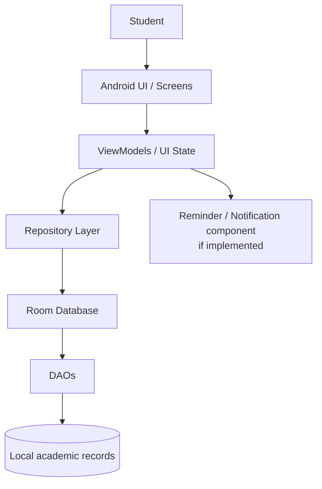
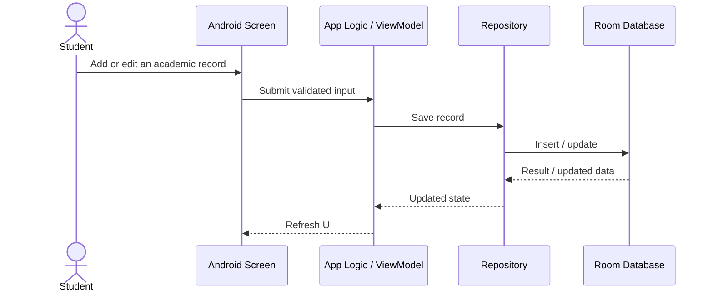

# My Scheduler — Technical Design Document

**Status:** Draft for repository/submission. Verify this document against the current implementation before treating it as an as-built design.

## 1. Purpose

My Scheduler is an Android academic planner intended to bring common student planning tasks—attendance, timetable, tasks/assignments, exams/reminders, and semester analysis—into one app. The known project direction is offline-first and uses Room for local persistence. Details not confirmed by the current code are explicitly marked for verification.

## 2. Scope

### In scope
- Create, view, update, and delete supported academic records.
- Store supported records locally for offline use.
- Present schedules and academic summaries.
- Provide reminders only where the current app implements them.

### Verify before claiming
- Google Sign-In, cloud sync, push notifications, AI features, data export/import, and any backend integration.
- Exact entities, fields, validation rules, and retention/deletion behavior.

## 3. High-level architecture

The diagram is a recommended logical architecture, not proof that the current source has each layer. Adjust names and remove components that do not exist in the code.

## 4. Data flow

If the actual implementation accesses Room directly from a screen or uses another pattern, update the diagram to match reality.

## 5. Data model (illustrative)

Use only entities and fields that exist in the actual database schema. The following is a conceptual model for planning and testing, not a statement of the shipped schema.

| Concept | Illustrative fields | Notes |
|---|---|---|
| AttendanceEntry | id, courseName, date, status, note | Status values and uniqueness rules must match implementation. |
| TimetableEntry | id, courseName, dayOfWeek, startTime, endTime, room | Validate time order and day representation. |
| Task | id, title, dueAt, completed, description | Due date may be optional if the app allows it. |
| Exam | id, courseName, startsAt, venue, note | Match actual exam fields. |
| Reminder | id, title, triggerAt, relatedRecordId | Include only if a persistent reminder model exists. |

## 6. Persistence and offline behavior

Known project context describes Room/local storage and offline operation. Verify the current implementation for:
- Room database version and migration strategy.
- Entity/DAO definitions and query behavior.
- Whether all features work offline or only local-record features.
- Backup, export/import, uninstall, and device-transfer behavior.
- Whether any feature sends data to a remote service.

## 7. Security and privacy

- Do not include real student records in the repository or sample data.
- Keep signing keys, passwords, tokens, and service credentials out of Git.
- Request only Android permissions needed by implemented features.
- Document notification permissions and exact data-sharing behavior if applicable.
- If authentication or cloud sync exists, document identity, access control, and deletion semantics from the real implementation.

## 8. Error handling and validation

Recommended behaviors to verify or implement:
- Reject empty required fields and invalid time ranges.
- Prevent accidental duplicate submissions where appropriate.
- Show a clear error if a save fails; do not silently discard user input.
- Handle missing notification permission or disabled notifications gracefully.
- Handle empty states and database migration failures safely.

## 9. Build and configuration

Record the actual values from project files:
- Android Studio version tested: `[FILL IN]`
- JDK: `[FILL IN]`
- Gradle wrapper / Android Gradle Plugin: `[FILL IN]`
- minSdk / targetSdk: `[FILL IN]`
- Required local configuration or secrets: `[FILL IN, or state none after verification]`

## 10. Verification plan

1. Clean clone and build using README instructions.
2. Install on a supported Android version.
3. Test create/read/update/delete for every supported record type.
4. Force-stop and relaunch to check persistence.
5. Enable airplane mode and verify documented offline flows.
6. Check input validation, empty states, and error messages.
7. Verify reminders/notifications only if implemented.
8. Inspect repository history and packaged APK/AAB for secrets and personal data.

## 11. Open decisions

- Confirm exact app architecture and database schema.
- Confirm which features are complete in the submitted build.
- Confirm privacy/data flow and whether any network service is used.
- Add screenshots, repository URL, demo URL, tested device/OS, and recorded test results.
